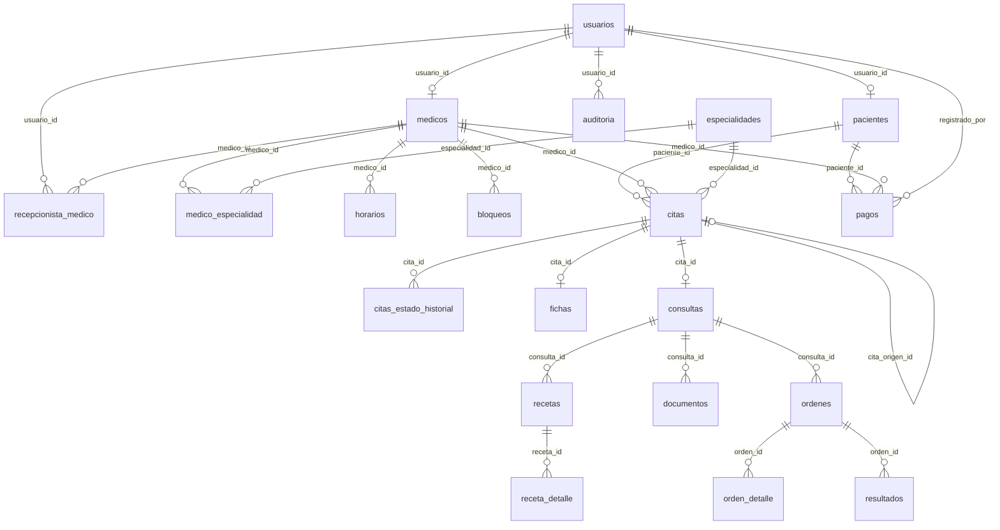

# Base de datos — Clínica Vida Salud

PostgreSQL 16. La fuente funcional es [`docs/specs/99-modelo-datos-rls.md`](../docs/specs/99-modelo-datos-rls.md).

## Comandos

```bash
# Aplicar migraciones pendientes (idempotente)
docker compose exec -T app php bin/db-migrate.php

# Cargar/actualizar datos demo (idempotente)
docker compose exec -T app php bin/db-seed.php

# Borrar datos y volver a cargar los seeders (destructivo)
docker compose exec -T app php bin/db-reset.php
```

Las migraciones viven en `database/migrations/` y los seeders en `database/seeders/`.
`schema_migrations` registra lo aplicado; `db:reset` no borra esa tabla.

## ERD resumido



## Grupos de tablas

| Grupo | Tablas |
|---|---|
| Identidad | `usuarios`, `pacientes`, `medicos`, `recepcionista_medico` |
| Catálogo | `especialidades`, `medico_especialidad` |
| Agenda | `horarios`, `bloqueos`, `citas`, `citas_estado_historial`, `fichas` |
| Historia clínica | `consultas`, `recetas`, `receta_detalle`, `documentos`, `ordenes`, `orden_detalle`, `resultados` |
| Operación | `pagos`, `auditoria`, `cola_correos` |

## Códigos visibles

Los códigos se generan en la base al insertar si no se envían explícitamente:

| Prefijo | Tabla | Ejemplo |
|---|---|---|
| `PAC-` | `pacientes` | `PAC-0001` |
| `MED-` | `medicos` | `MED-0001` |
| `CM-` | `citas` | `CM-0001` |
| `FIC-` | `fichas` | `FIC-0001` |
| `RSV-` | `recetas` | `RSV-000001` |
| `DOC-` | `documentos` | `DOC-000001` |
| `ORD-` | `ordenes` | `ORD-000001` |

Los códigos de acceso de recetas, documentos, órdenes y fichas son de 4 dígitos y se validan con un `CHECK`.

## RLS y roles

- `clinica` es el rol propietario y se usa para migraciones/seeders.
- `clinica_app` es el rol de la aplicación. No es propietario ni superusuario; las políticas RLS se aplican.
- `clinica_kiosk` queda creado para la fase del kiosco (permisos y políticas se agregan en M-23).
- El contexto se setea desde PHP con `DB::setContext()`:
  - `app.usuario_id`
  - `app.rol`
  - `app.medico_id`
  - `app.ip`

Políticas principales:

| Rol | Alcance |
|---|---|
| `super_admin`, `admin` | Todo |
| `recepcionista` | Pacientes, citas, agenda y operación |
| `recepcionista_medico` | Solo sus médicos asignados |
| `medico` | Solo sus pacientes, citas e historia |
| `paciente` | Solo su propio perfil, citas e historia |

La auditoría se escribe con `fn_auditar()` (`SECURITY DEFINER`). El rol de la app no puede insertar, actualizar ni borrar filas de `auditoria`.

## Datos demo

`db:seed` crea:

- 5 especialidades, 3 destacadas.
- 4 médicos, 2 asignados a la recepcionista médica.
- Horarios de lunes a viernes (08:00–12:00 y 14:00–18:00) con cupos 50/50.
- 4 pacientes (uno vinculado a la cuenta `paciente`).
- 5 citas: 2 pasadas atendidas y 3 futuras (confirmada/programadas).
- 3 fichas, 2 consultas, 2 recetas, 1 documento, 1 orden con resultados y 2 pagos.

Credenciales: [`docs/equipo/CREDENCIALES-DEV.md`](../docs/equipo/CREDENCIALES-DEV.md).

## Convenciones

- Zona horaria de la aplicación: `America/La_Paz`.
- Fechas `YYYY-MM-DD`; horas `HH:MM`.
- Borrado lógico mediante `estado`/`activo`; no se eliminan pacientes, médicos ni historiales.
- Los enums y códigos están alineados con los contratos de [`docs/api/contract.md`](../docs/api/contract.md).
