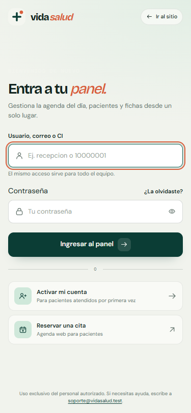
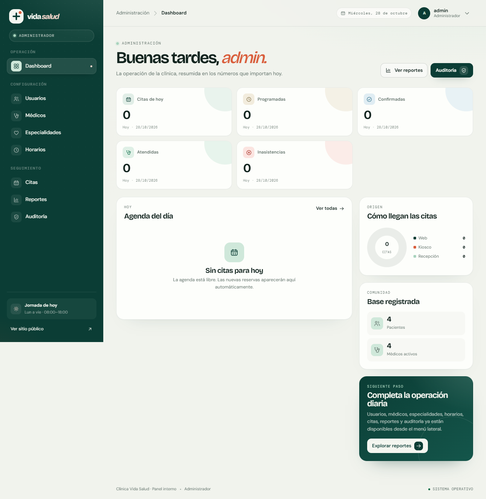
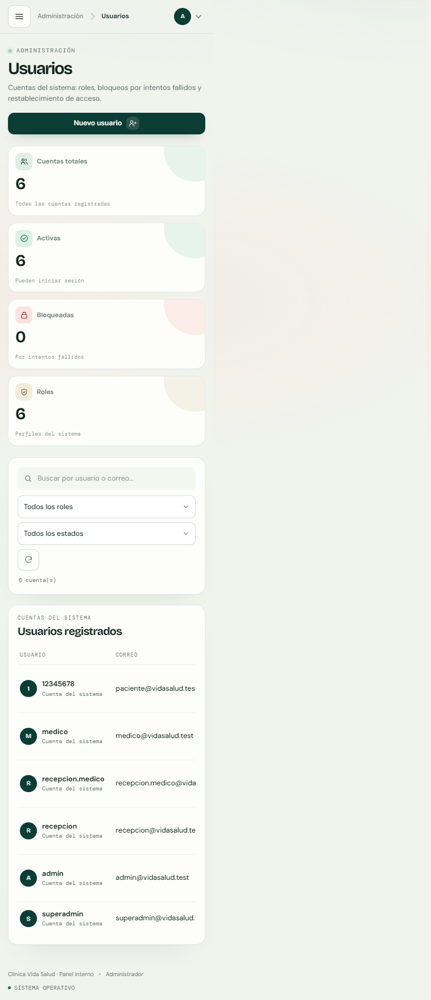
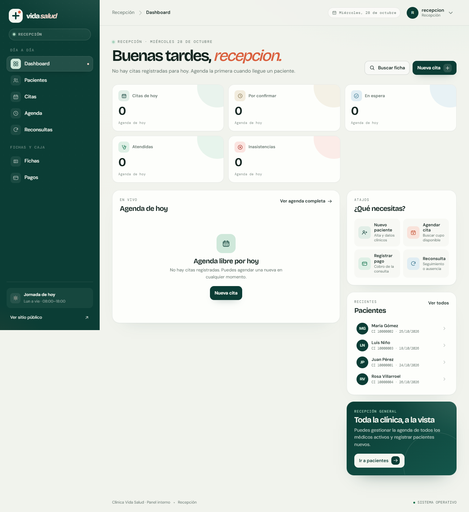
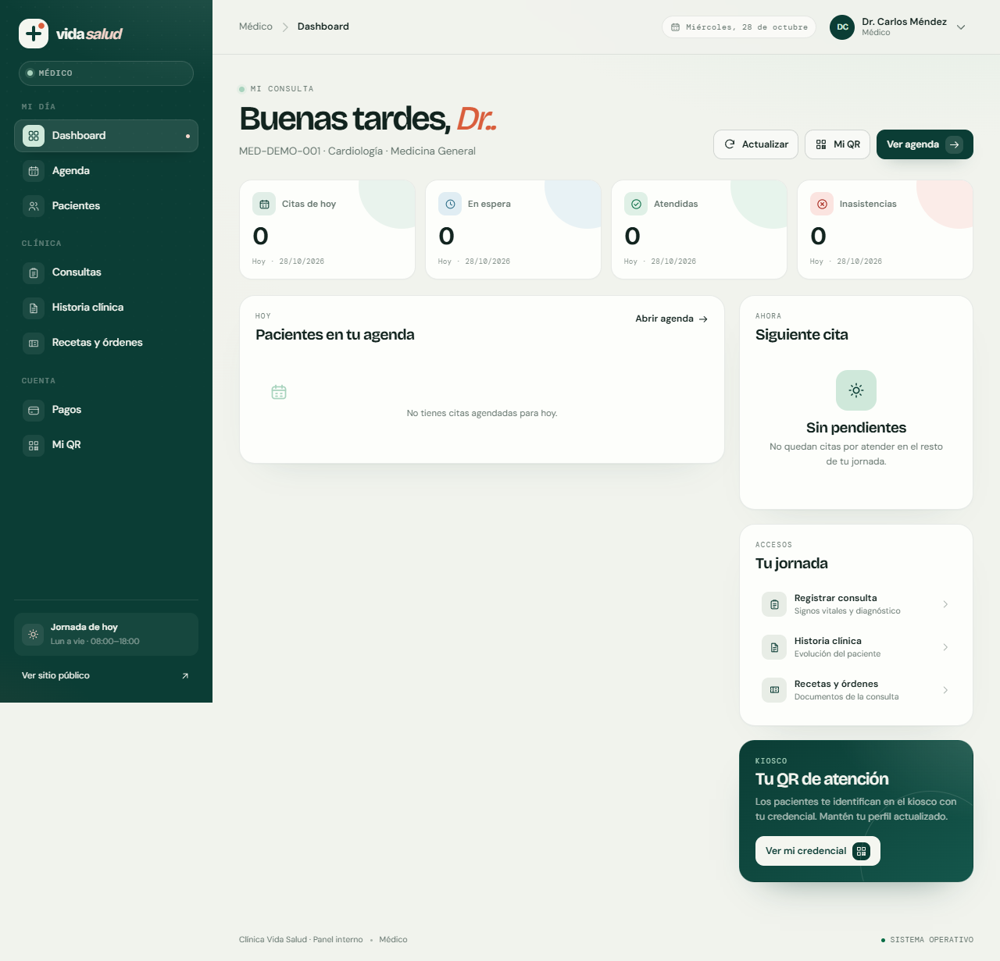
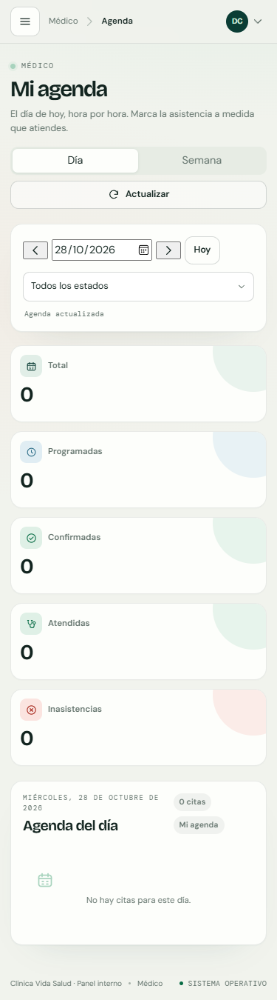
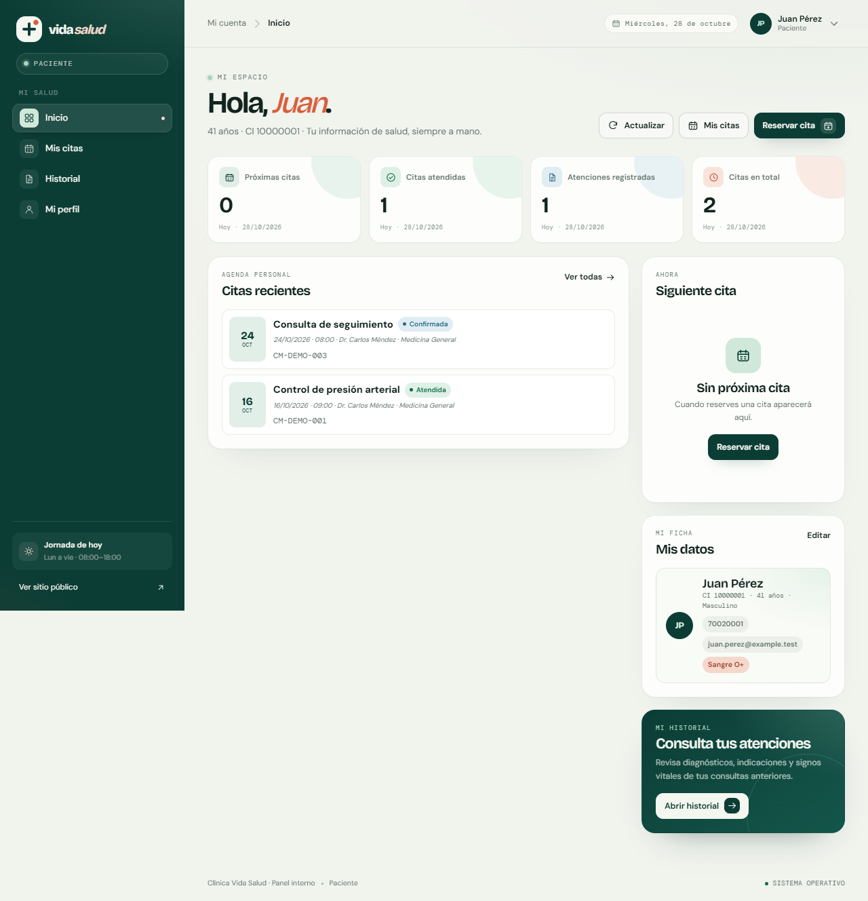
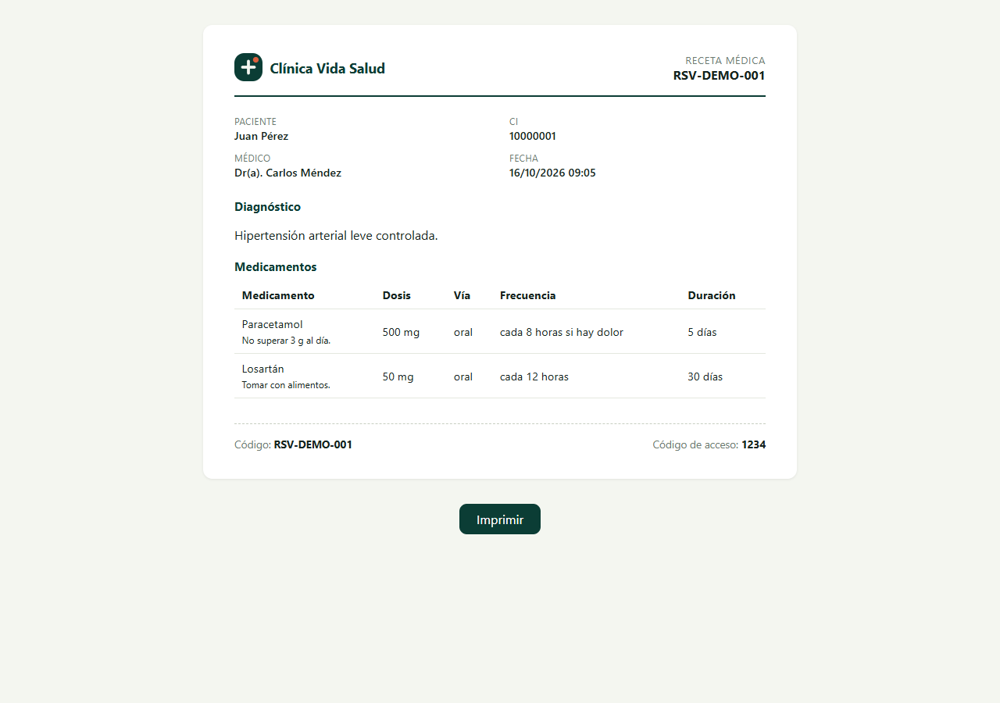
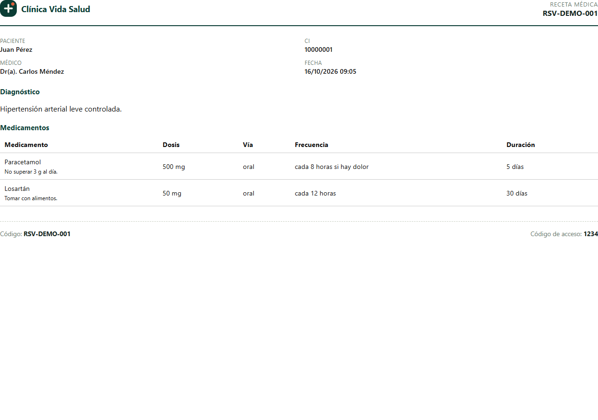
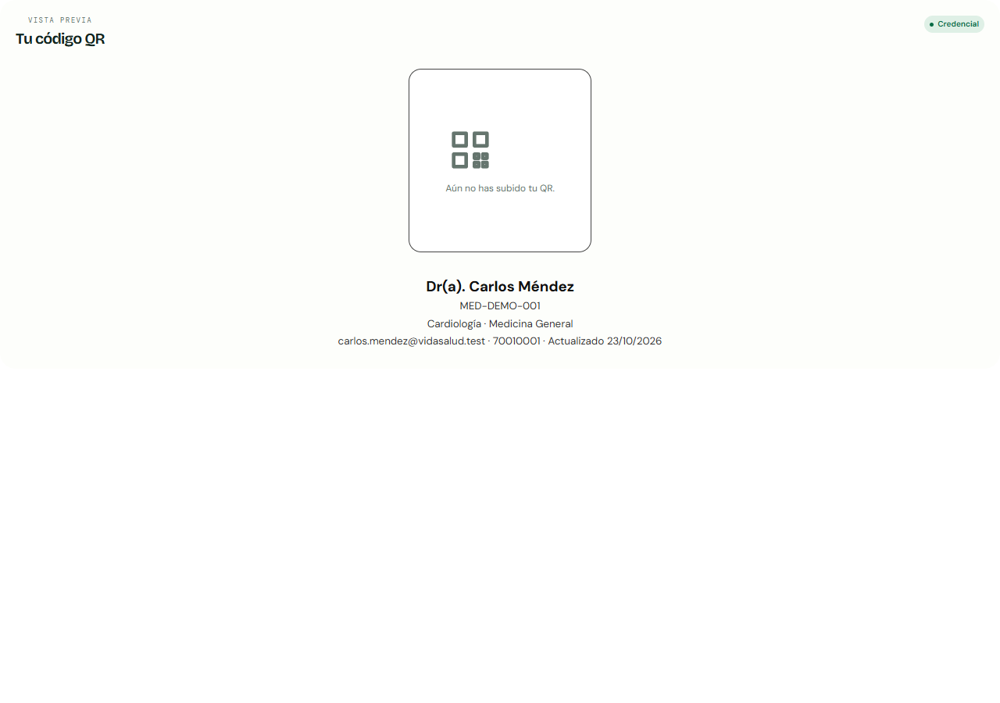

# Panel interno — guía y QA

> Estado: L-34, L-35, L-36 y L-37 cerradas el **2026-10-28**.
> Dueño de las vistas y assets: **Lucas**. Backend, base de datos y APIs: **Matias**.

## 1. Arranque local

```bash
docker compose up -d
docker compose exec app php bin/db-migrate.php
docker compose exec app php bin/db-seed.php
```

- Panel: <http://localhost:8080/login>
- Mailpit: <http://localhost:8025>
- Credenciales demo: [`CREDENCIALES-DEV.md`](./CREDENCIALES-DEV.md)
- Contraseña común: `Demo1234!`

> Si la base ya existía, ejecuta las migraciones pendientes. La migración
> `011_fichas_reimpresiones.sql` es necesaria para que `/recepcion/fichas` no
> devuelva `500` en `GET /api/fichas`.

## 2. Roles y rutas

| Rol | Home | Rutas del panel |
|---|---|---|
| `super_admin` / `admin` | `/admin` | `/admin/usuarios`, `/admin/medicos`, `/admin/especialidades`, `/admin/horarios`, `/admin/citas`, `/admin/reportes`, `/admin/auditoria` |
| `recepcionista` | `/recepcion` | `/recepcion/pacientes`, `/recepcion/citas`, `/recepcion/agenda`, `/recepcion/reconsultas`, `/recepcion/fichas`, `/recepcion/pagos` |
| `recepcionista_medico` | `/recepcion` | Las mismas rutas de recepción, con alcance limitado a sus médicos (`medico_ids`). |
| `medico` | `/medico` | `/medico/agenda`, `/medico/pacientes`, `/medico/consultas`, `/medico/historia`, `/medico/pedidos`, `/medico/pagos`, `/medico/qr` |
| `paciente` | `/portal` | `/portal/mis-citas`, `/portal/historial`, `/portal/perfil` |

Los guards de rol viven en `app/routes/panels.php` y en el middleware de roles.
Si un usuario entra a un panel que no le corresponde, el sistema lo redirige a
su propio home.

## 3. Shell y navegación

- Shell en `app/views/layouts/gentelella.php`; menú por rol en
  `app/views/layouts/menu.php`.
- Sidebar fijo en escritorio y drawer con backdrop por debajo de `1160px`.
- El botón de menú expone `aria-controls` y `aria-expanded`.
- Al abrir el drawer el foco entra al botón de cierre; `Tab`/`Shift+Tab` quedan
  atrapados dentro del sidebar y `Escape` lo cierra devolviendo el foco al botón.
- Los modales usan `role="dialog"`, `aria-modal="true"` y atrapan el foco.
  `Escape` cierra y devuelve el foco al disparador.
- Las pestañas segmentadas (`role="tablist"`) responden a flechas, `Home` y
  `End`; solo la pestaña activa queda en el orden de tabulación.
- Enlace “Saltar al contenido” al inicio de cada shell.

### Responsive

Breakpoints principales en `public/assets/panel/css/responsive.css`:

| Ancho | Comportamiento |
|---|---|
| `> 1320px` | Layout completo, KPIs en 5 columnas. |
| `1161–1320px` | Ajuste de grillas y sidebar fijo. |
| `761–1160px` | Sidebar como drawer; topbar compacto. |
| `481–760px` | Una columna, tablas con scroll interno, modales a pantalla completa. |
| `≤ 400px` | Padding reducido, modales tipo bottom-sheet, tipografía y QR ajustados. |

Las tablas anchas viven dentro de `.table-wrap` con scroll horizontal propio;
la página no gana scroll lateral. En móvil el sidebar cerrado queda
`visibility: hidden` + `inert`.

## 4. Estados y feedback

Los módulos comparten `public/assets/panel/js/app.js` y los helpers de cada rol
(`admin-shared.js`, `recepcion-shared.js`, `medico-shared.js`,
`paciente-shared.js`):

- **Loading:** skeletons (`.skeleton`, `.table-loading`) y botones con spinner
  mediante `setLoading()`.
- **Empty:** `.empty-state` con icono, mensaje y acción opcional.
- **Error:** `.error-state` con mensaje traducido y botón “Reintentar”.
- **Toasts:** éxito, error, aviso e información; `role="status"` o `alert`.
- **Confirmaciones:** `confirmAction()` para acciones destructivas, con foco
  inicial en el botón de confirmar y retorno de foco al terminar.
- **Formularios:** errores `422` por campo con `aria-invalid`, foco al primer
  campo inválido y mensajes bajo el input.

## 5. Impresión

| Documento | Implementación |
|---|---|
| Ficha de atención | `printDocument()` en `public/assets/panel/js/recepcion-fichas.js` genera un iframe con ticket centrado, `@page A4`, colores forzados y `break-inside: avoid`. |
| Receta / documento / orden | `app/views/layouts/imprimible.php` + `app/views/pedidos/*.php`. Layout A4 con `@page`, tablas que repiten cabecera y acciones ocultas al imprimir. |
| QR del médico | `/medico/qr` usa `public/assets/panel/css/print.css`; al imprimir oculta el panel y deja solo la credencial centrada (62 mm). |
| Listados y modales | `print.css` oculta sidebar, topbar, acciones, paginación y toasts; si hay un modal abierto imprime solo su contenido. |

Para revisar sin impresora: en DevTools → *Rendering* → *Emulate CSS media type:
print*, o con Playwright `page.emulateMedia({ media: 'print' })`.

## 6. QA ejecutado (2026-10-28)

Entorno: Docker local (`http://localhost:8080`), Postgres 16, datos seed.
Navegador: Microsoft Edge headless vía Playwright (`playwright-core`).

### Cobertura E2E por rol

| Rol | Páginas visitadas | Resultado |
|---|---|---|
| `admin` | 8 | OK |
| `recepcionista` | 7 | OK |
| `recepcionista_medico` | 7 | OK |
| `medico` | 8 | OK |
| `paciente` | 4 | OK |

Se verificó en cada página:

- respuesta `200`, un solo `<h1>`, `<main>` con contenido;
- sin errores de consola ni `pageerror`;
- sin respuestas `4xx/5xx` de APIs;
- sin scroll horizontal de página a `375`, `768` y `1280px`;
- apertura/cierre del sidebar móvil con foco atrapado y retorno al disparador;
- redirección segura al intentar entrar a un panel ajeno.

### Accesibilidad

- 34 vistas de panel y 3 vistas de autenticación sin inputs sin nombre
  accesible, botones/enlaces sin texto, imágenes sin `alt`, `aria-labelledby`
  rotos ni IDs duplicados.
- `#auth-title` presente en login, recuperar, reset y activar.
- Foco visible en enlaces, botones, inputs, tabs y navegación del sidebar.
- Contraste reforzado en etiquetas y textos secundarios del sidebar.

### Impresión

- Receta, documento y orden: `200`, `@page A4`, acciones ocultas, sin overflow
  a `375px`.
- Ficha: el iframe incluye `@page`, `print-color-adjust: exact` y ejecuta
  `print()`.
- QR: al emular impresión desaparecen topbar/sidebar y la credencial queda a
  62 mm.

## 7. Capturas

| Vista | Captura |
|---|---|
| Login 375px |  |
| Admin dashboard |  |
| Admin usuarios 375px |  |
| Recepción dashboard |  |
| Médico dashboard |  |
| Médico agenda 375px |  |
| Portal paciente |  |
| Receta en pantalla |  |
| Receta en impresión |  |
| QR en impresión |  |

## 8. Limitaciones conocidas

- **Cambio de contraseña del paciente (M-33):** la vista existe, pero la API
  todavía no expone el endpoint; no se inventó uno desde el panel.
- **Historial de recetas/documentos/órdenes (L-30):** no hay endpoint de
  listado histórico; se muestran las consultas recientes y los pedidos de la
  sesión.
- **Guards de panel:** las rutas ajenas redirigen al home del rol en lugar de
  renderizar una página 403. El acceso queda bloqueado, pero si se quiere una
  pantalla 403 explícita hay que acordarlo con Matias.
- **E2E:** el runner usado fue un script local con Playwright + Edge; no se
  agregó como dependencia del repo. La matriz y la evidencia quedan en este
  documento y en `capturas/`.

## 9. Archivos clave

| Archivo | Uso |
|---|---|
| `app/views/layouts/gentelella.php` | Shell del panel, carga de CSS/JS, skip link, print.css. |
| `app/views/layouts/menu.php` | Menú por rol y estado activo. |
| `app/views/layouts/auth.php` | Shell de autenticación. |
| `public/assets/panel/js/app.js` | Red, toasts, modales, foco, tabs, formato. |
| `public/assets/panel/css/tokens.css` | Tokens, shell, sidebar, topbar, foco. |
| `public/assets/panel/css/components.css` | Componentes, tablas, modales, estados. |
| `public/assets/panel/css/pages.css` | Estilos por módulo. |
| `public/assets/panel/css/responsive.css` | Breakpoints y reduced motion. |
| `public/assets/panel/css/print.css` | Impresión del panel (A4). |
| `app/views/layouts/imprimible.php` | Receta, documento y orden imprimibles. |
